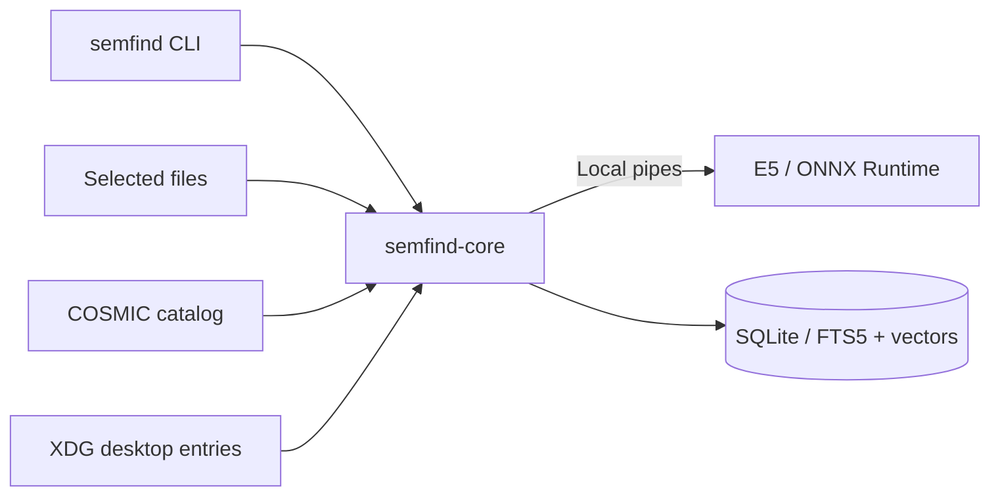

# Architecture

## Write path

`Index::synchronize` reconciles one explicitly selected root and the versioned built-in settings catalog. It compares hashes of source bytes to skip unchanged content and deletes records missing from the completed scan. A scan failure or embedding error rolls back the transaction. Supported files that cannot be read or extracted are reported and omitted, including any prior contents. The index keeps roots, saved exclusions, source metadata, normalized little-endian float vectors, and FTS5 rows keyed by passage ID. Foreign keys and a delete trigger keep passage and FTS rows aligned.

`Index::initialize_home` reconciles the home directory and adds registered desktop applications in the same transaction. Entries are keyed by desktop file ID and discovered in XDG preference order, with the user directory first. Application embeddings use the desktop name, description, and keywords.

Extracted text is broken at nearby word boundaries, up to 640 Unicode characters with about 80 characters of overlap. Embeddings include a clipped title and use E5's `query:` and `passage:` prefixes. Python tokenizes to at most 512 tokens, runs CPU inference and mean-pools unmasked output tokens. Rust checks dimensions and normalizes vectors. The tokenizer and weight checksums plus an encoding recipe version identify the vector space. A different identity requires a separate or rebuilt index.

## Read path

Path, extension, file kind and result category define the result set. The index confirms that each file still opens under its registered root before considering its saved contents. FTS5 ranks escaped terms with BM25. Cosine similarity ranks stored vectors, taking the best passage per source in each retrieval channel. The local E5 encoder requires a cosine similarity of at least 0.78 to contribute to the semantic ranking. This cutoff is a heuristic calibrated on a small set of German and English queries and can exclude weak paraphrases. Full-text and exact matches remain eligible independently. The query encoder starts only when there are eligible vectors. Image and video records have an FTS5 row for their filename and path and an empty vector field. Reciprocal Rank Fusion combines the top candidates from each list with k = 60. Full path, filename and settings ID matches rank first, then literal code matches in passages. Remaining ties are deterministic.

## Trade-offs

- **SQLite with bundled FTS5.** One portable database keeps full-text and vector updates atomic. [sqlite-vec's Rust bindings](https://github.com/asg017/sqlite-vec/blob/main/site/using/rust.md) support static registration with bundled rusqlite. The MVP uses a streamed, exact cosine scan in Rust to keep vector dimensions model-independent and avoid an additional native extension. A larger corpus will need measured latency and recall before moving to an approximate index.
- **Local Python inference process.** ONNX Runtime and the upstream tokenizer run as a child of the Rust application. The child is reused across batches during one command. This keeps inference separate from retrieval, with the cost of a Python setup and a fresh model load on each invocation. The `Embedder` trait is the boundary for alternate runtimes.
- **Manual reconciliation.** Scans hash every eligible file and run one transaction per selected root. This handles removal, interrupted scans, and changes that leave timestamps unchanged. Opening a current-schema index for reading takes no write reservation. Readers can observe the last committed snapshot while a scan holds a write reservation, and SQLite still serializes exclusive phases of the write. The trade-offs are read I/O on every scan and a write lock during inference. A service can reuse the same schema and retrieval interface while staging work in smaller transactions.
- **Historical data.** Future history and restore would use dedicated storage and index records with distinct source identities. This schema holds the current indexed snapshot.
