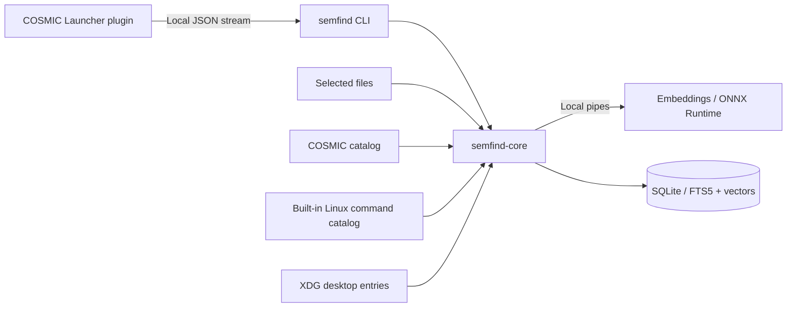

# Architecture

## Write path

`Index::synchronize` reconciles an optionally selected root and the built-in settings and command catalogs. It compares hashes of source bytes to skip unchanged content and deletes records missing from the completed scan. A scan failure or embedding error rolls back the transaction. Supported files that cannot be read or extracted are reported and omitted, including any prior contents. The index keeps roots, saved exclusions, source metadata, normalized little-endian float vectors, and FTS5 rows keyed by passage ID. Foreign keys and a delete trigger keep passage and FTS rows aligned.

`Index::initialize_home` reconciles the home directory, desktop applications, and local commands in the same transaction. Application entries are keyed by desktop file ID and discovered in XDG preference order, with the user directory first. Application embeddings use the desktop name, description, and keywords.

`semfind init --force` replaces the saved sources and embedding metadata within the same write transaction. It retains registered roots and exclusions, then scans all roots and rebuilds the catalogs using the selected embedding model. An unavailable registered root or a failed model inference rolls back the rebuild.

Built-in command and settings entries keep translated descriptions in separate passages under a shared source ID. Commands also store an example and a distribution family. The CLI detects the family at search time so an index can contain both Debian and Arch variants. The distribution filter applies before ranking.

`init` and `index --manpages` refresh locally installed command records. The scan extracts bounded excerpts from command manual sections and records each manual's name and section. Executable names without a manual use lexical-only records. The built-in and local command entries reconcile independently.

Extracted text is broken at nearby word boundaries, up to 640 Unicode characters with about 80 characters of overlap. Each file passage stores its one-based line range or its physical PDF page. PDF passages stop at page boundaries. Opening an older index adds nullable location columns. A rescan refreshes existing text passages and their locations. Embeddings include a clipped title. Python tokenizes up to 512 tokens for Granite, E5, GTE, and Qwen3, and up to 2048 tokens for EmbeddingGemma. The worker tries NVIDIA CUDA, AMD MIGraphX, and the CPU in that order. In automatic mode it retries a failed GPU inference on the CPU. All backends share the model identity. Granite uses CLS pooling on unprefixed text. E5 uses `query:` and `passage:` prefixes and mean-pools unmasked output tokens. EmbeddingGemma uses separate search and document prompts and reads the final sentence embedding from the ONNX graph. Rust checks dimensions and normalizes vectors. The tokenizer and weight checksums plus an encoding recipe version identify the vector space. A different identity requires a separate or rebuilt index.

When the local Florence-2 checkpoint is installed, `init` reads JPEG, PNG, and WebP bytes through the existing file access checks. The same captioning is available for selected roots through `index ROOT --caption-images`. The scanner starts the local Florence-2 worker when it first needs a caption and sends the image bytes over a pipe. Saved caption digests include the image bytes and the checkpoint and recipe identity, so switching the caption prompt or model regenerates descriptions on the next caption-enabled scan. If caption inference fails during `init`, the scan keeps existing captions and completes with filename and path indexing for the remaining images. Scans with captioning disabled preserve existing captions without reading image contents.

EmbeddingGemma 2 uses a PyTorch worker to encode text and image bytes into a shared vector space. The scanner stores a direct image embedding alongside a filename-only FTS passage. The search worker only encodes the text query. When switching to or from a direct image model, `reindex` rereads images from registered folders while rebuilding text vectors in the same transaction. Image vectors use cosine ranking without the text model's calibrated default cutoff.

## Read path

Path, extension, file kind and result category define the result set. The index confirms that each file still opens under its registered root before considering its saved contents. FTS5 ranks escaped terms with BM25. Cosine similarity ranks stored vectors, taking the best passage per source in each retrieval channel. Each built-in model has a cosine similarity cutoff. Granite 97M (0.86), Granite 311M (0.88), and E5 Large (0.80) use values from the separate validation queries in the [retrieval benchmark](../benchmarks/retrieval/README.md). E5 Small retains the 0.78 cutoff. Custom models can specify an optional cutoff and their encoding settings in `semfind-model.json`. Full-text and exact matches remain eligible independently. The query encoder starts only when there are eligible vectors. Image captions use the same FTS5 and embedding paths as document passages. Uncaptioned images and videos have a filename and path row with an empty vector field. Reciprocal Rank Fusion combines the top candidates from each list with k = 60. Full path, filename and settings ID matches rank first, then literal code matches in passages. Remaining ties are deterministic.

## Trade-offs

- **SQLite with bundled FTS5.** One portable database keeps full-text and vector updates atomic. [sqlite-vec's Rust bindings](https://github.com/asg017/sqlite-vec/blob/main/site/using/rust.md) support static registration with bundled rusqlite. The MVP uses a streamed, exact cosine scan in Rust to keep vector dimensions model-independent and avoid an additional native extension. A larger corpus will need measured latency and recall before moving to an approximate index.
- **Local Python inference process.** ONNX Runtime and the upstream tokenizer run as a child of the Rust application. The child is reused across batches during one command. This keeps inference separate from retrieval, with the cost of a Python setup and a fresh model load on each invocation. The `Embedder` trait is the boundary for alternate runtimes.
- **Manual reconciliation.** Scans hash every eligible file and run one transaction per selected root. This handles removal, interrupted scans, and changes that leave timestamps unchanged. Opening a current-schema index for reading takes no write reservation. Readers can observe the last committed snapshot while a scan holds a write reservation, and SQLite still serializes exclusive phases of the write. The trade-offs are read I/O on every scan and a write lock during inference. A service can reuse the same schema and retrieval interface while staging work in smaller transactions.
- **Historical data.** Future history and restore would use dedicated storage and index records with distinct source identities. This schema holds the current indexed snapshot.
